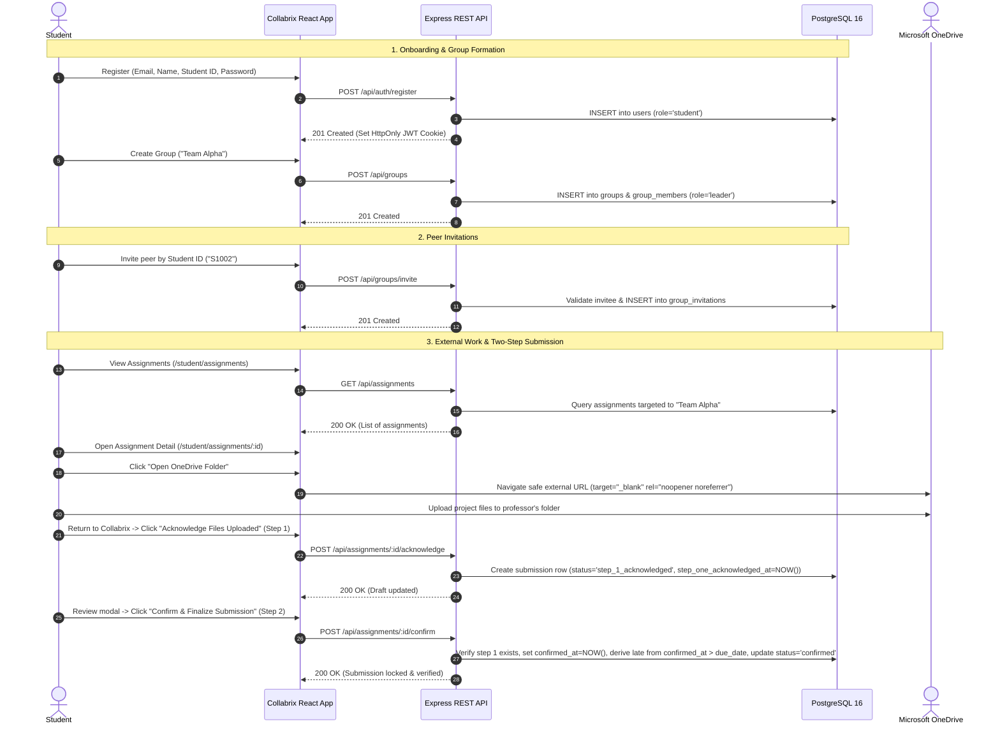
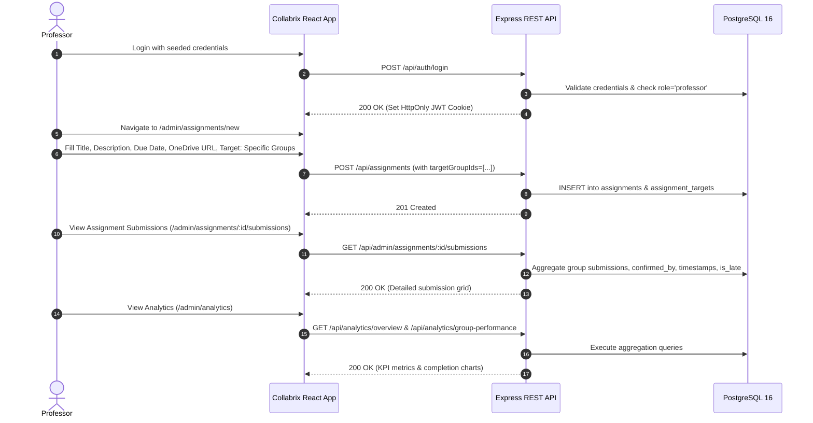
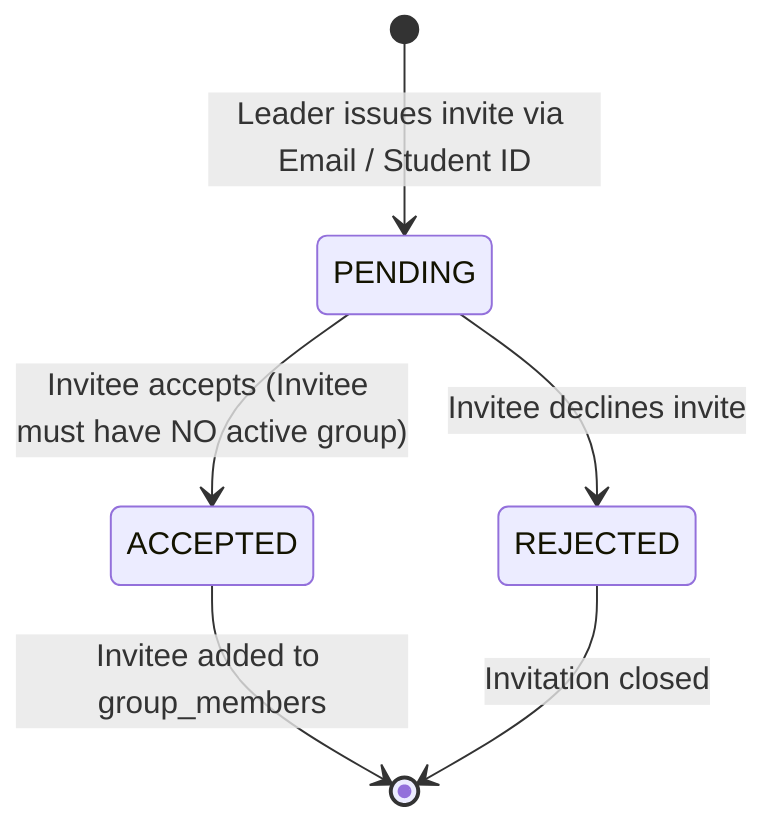
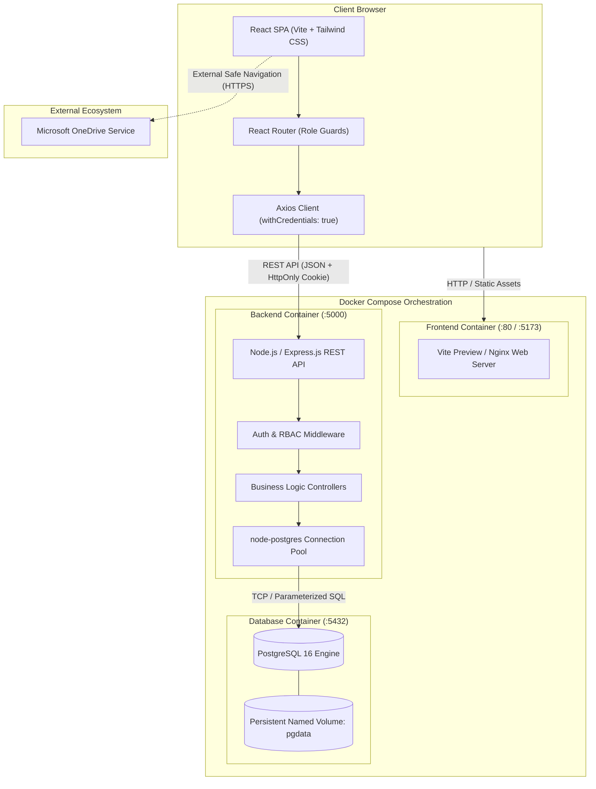
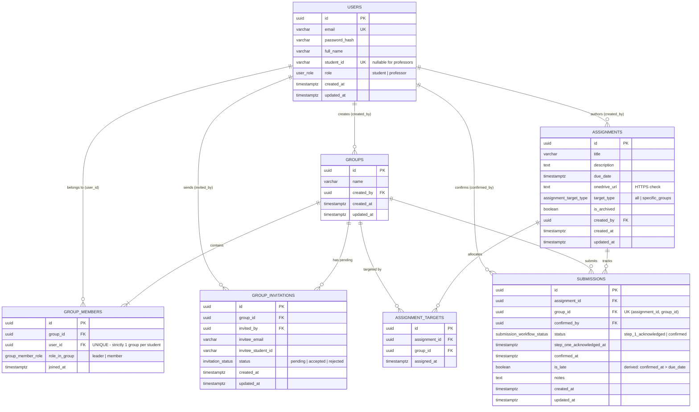
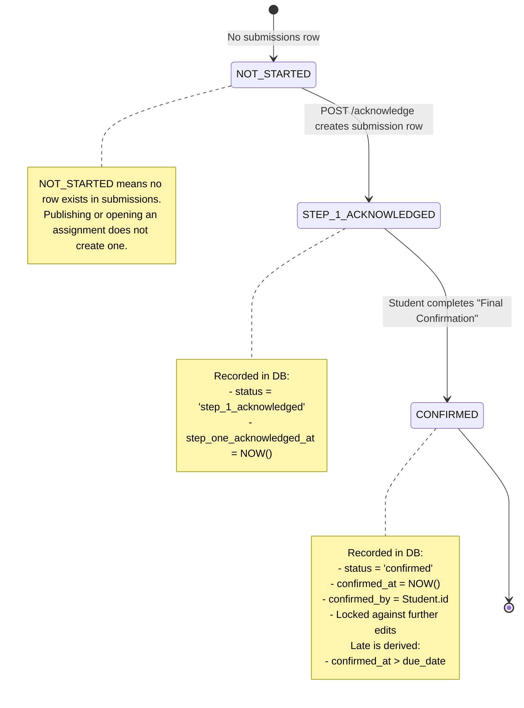
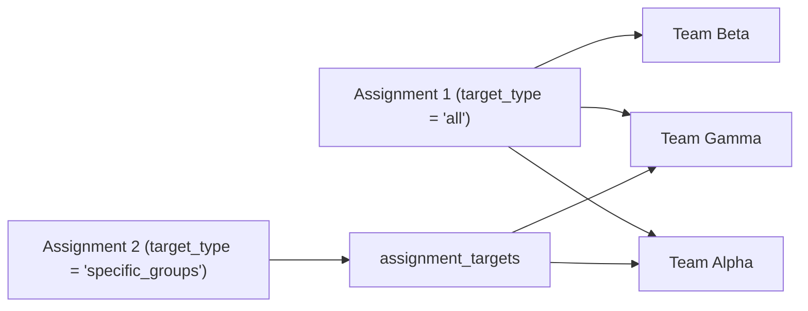
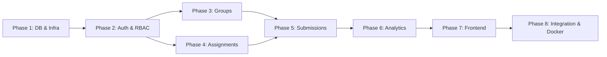

# Technical Design Document: Collabrix
**Student Groups & Assignment Management System**

---

## 1. Project Overview

**Collabrix** is a full-stack, role-based academic collaboration platform designed to streamline student project groups, manage assignment lifecycles, and track submission progress. 

The application solves a common friction point in higher education: coordinating collaborative team assignments when coursework deliverables are hosted on external institutional drives (specifically Microsoft OneDrive). Rather than attempting to duplicate heavy cloud file storage engines within the application, Collabrix acts as the workflow coordinator, assignment tracker, and verified submission ledger. 

Professors publish assignments with external OneDrive submission directories, while student teams form groups, collaborate on their deliverables externally, and complete a verified **two-step submission confirmation** process within Collabrix. The platform provides professors with real-time audit logs, completion tracking, and actionable group-performance analytics.

---

## 2. Goals and Scope

### 2.1 Primary Goals
1. **Streamlined Group Formation**: Allow students to form project groups, assign group leaders, and invite peers via institutional email or Student ID.
2. **Assignment Orchestration**: Enable professors to publish course assignments with descriptive guidelines, hard deadlines, and dedicated Microsoft OneDrive upload links.
3. **Flexible Assignment Targeting**: Support both class-wide assignments and selective targeting to specific project groups without duplicating assignment records.
4. **Verified Two-Step Submission Workflow**: Implement a strict, server-enforced two-step submission confirmation process that records an immutable audit trail of who submitted, when, and whether it was on-time.
5. **Auditing & Basic Analytics**: Provide professors with transparent visibility into submission rates, on-time versus late turn-ins, and group progress metrics.
6. **Containerized Portability**: Ensure the complete multi-tier application (React frontend, Node.js backend, and PostgreSQL database) runs seamlessly via Docker Compose.

### 2.2 Operational Scope
- The system is bounded to managing user accounts, group memberships, assignment metadata, target relationships, submission confirmations, and analytical summaries.
- Deliverables (documents, slide decks, source archives) reside entirely within Microsoft OneDrive. Collabrix strictly stores the external HTTPS URI and manages the submission confirmation state.

---

## 3. Functional Requirements

### 3.1 Student Functionality
- **Registration & Authentication**: Public self-registration using Full Name, University Email, Student ID, and Password. Secure login via JWT.
- **Group Creation**: Create a collaborative project group. The creator is automatically designated as the Group Leader.
- **Group Management & Invitations**:
  - The group leader can invite students using their University Email or Student ID.
  - Invited students can view pending invitations and accept or reject them.
  - A student can belong to only **one active group at a time**.
  - Leaders can remove members or disband the group (if no submissions are tied to it).
- **Assignment Discovery**: View all active and past assignments targeted to the student's group or to all students.
- **External Submission Access**: One-click safe navigation to the professor's specified OneDrive folder.
- **Two-Step Confirmation**:
  - *Step 1 (Acknowledgment)*: Confirm that the group has uploaded its final files to the OneDrive folder.
  - *Step 2 (Final Confirmation)*: Finalize the group submission, triggering server-side timestamping, derived lateness calculation, and submission locking.
- **Progress Tracking**: Monitor group submission statuses (`NOT_STARTED`, `STEP_1_ACKNOWLEDGED`, and `CONFIRMED`) across all assigned tasks. `NOT_STARTED` means no row exists in `submissions`; assignment, visibility, or opening the assignment detail does not create one. Lateness is not a submission lifecycle state: a confirmed submission is late when `confirmed_at > due_date`.

### 3.2 Professor / Admin Functionality
- **Authentication**: Access via pre-provisioned, seeded administrative credentials (no public self-registration).
- **Assignment Management (CRUD)**:
  - Create assignments containing Title, Description, Due Date (UTC), and a validated HTTPS OneDrive URL.
  - Edit active assignment parameters and update target groups.
  - Soft-delete / archive past assignments to preserve historical submission integrity.
- **Targeting Flexibility**:
  - Target assignments to **All Groups** (class-wide).
  - Target assignments to **Specific Groups** via a multi-select relationship table.
- **Submission Tracking**:
  - View real-time submission tables per assignment.
  - Track group-level confirmation status, the student who confirmed, acknowledgment timestamps, final confirmation timestamps, and on-time/late flags.
- **Performance Analytics**:
  - High-level KPIs: Total assignments, total groups, overall submission completion percentage, and on-time vs. late ratios.
  - Group-by-group performance breakdowns.

---

## 4. Non-Goals / Out of Scope

To maintain high architectural cohesion and stay aligned with the project requirements, the following features are strictly out of scope:
- **Internal File Storage / Uploads**: No direct file uploads, multipart parsing, AWS S3/Azure Blob integrations, or virus scanning within Collabrix. All files remain on OneDrive.
- **Real-Time Chat & Direct Messaging**: No WebSockets, peer-to-peer chats, or forum discussion boards.
- **Social / Third-Party OAuth**: No Google, GitHub, or Microsoft OAuth logins. Standard email/password authentication is used.
- **Notification Services**: No automated email, SMS, or push notification engines.
- **Automated Grading & AI Utilities**: No automated code execution, plagiarism checks, or LLM-driven grading assistants.
- **Public Professor Self-Registration**: No public registration toggle or access-code form for professors; accounts are strictly seeded.

---

## 5. User Roles

The system enforces a strict two-role model:

| Role | Provisioning Method | Permissions & Responsibilities |
| :--- | :--- | :--- |
| **`student`** | Public self-registration via `/register` (requires unique `student_id` and university `email`). | Can form/join one group, invite peers, accept/reject group invites, view assigned assignments, access OneDrive links, and execute two-step submission confirmations. |
| **`professor`** | System-provisioned via database seeding (`seed.sql`). | Can create, edit, archive assignments, assign tasks to groups, view submission audit logs across all groups, and view class analytics. |

---

## 6. User Flows

### 6.1 End-to-End Student Workflow



### 6.2 End-to-End Professor Workflow



### 6.3 Group Invitation Lifecycle



---

## 7. System Architecture

Collabrix is implemented as a decoupled, multi-container architecture.



---

## 8. Technology Stack

| Layer | Technology | Selection Rationale |
| :--- | :--- | :--- |
| **Frontend Framework** | **React.js 18 + Vite** | High developer velocity, rapid HMR, modern ES modules, and lightweight bundle footprint. |
| **Styling** | **Tailwind CSS** | Utility-first CSS ensuring consistent spacing, accessible color palettes, and responsive UI components without bloated CSS files. |
| **UI Component Library** | **shadcn/ui for React** | Provides accessible, reusable React components built with Tailwind CSS for consistent buttons, dialogs, forms, cards, tables, badges, and other UI elements. |
| **Routing** | **React Router v6** | Declarative client-side routing with nested layouts and role-based route guards (`ProtectedRoute`). |
| **HTTP Client** | **Axios** | Robust support for automatic cookie transmission (`withCredentials: true`), request/response interceptors, and error handling. |
| **Icons** | **Lucide React** | Clean, lightweight SVG icon set for accessible UI visual cues. |
| **Backend Runtime** | **Node.js 20 LTS + Express.js** | Reliable, asynchronous event-driven I/O model suited for RESTful microservices. |
| **Database** | **PostgreSQL 16** | ACID-compliant relational database providing strict foreign key cascades, unique constraints, and JSON aggregation. |
| **DB Driver** | **node-postgres (`pg`)** | Low-overhead connection pooling using strictly parameterized SQL queries to prevent SQL injection vulnerabilities. |
| **Authentication** | **JWT (`jsonwebtoken`) + `bcryptjs`** | Stateless authentication using industry-standard HMAC SHA-256 tokens stored in secure HttpOnly cookies, combined with 12-round bcrypt salt hashing. |
| **Infrastructure** | **Docker & Docker Compose** | Reproducible multi-container orchestration isolating frontend, backend, and database environments. |

---

## 9. Database Design

### 9.1 Custom ENUM Types

```sql
CREATE TYPE user_role AS ENUM ('student', 'professor');
CREATE TYPE group_member_role AS ENUM ('leader', 'member');
CREATE TYPE invitation_status AS ENUM ('pending', 'accepted', 'rejected');
CREATE TYPE assignment_target_type AS ENUM ('all', 'specific_groups');
CREATE TYPE submission_workflow_status AS ENUM ('step_1_acknowledged', 'confirmed');
```

### 9.2 Complete Relational Schema (PostgreSQL 16 DDL)

```sql
-- 1. Users Table
CREATE TABLE users (
    id UUID PRIMARY KEY DEFAULT gen_random_uuid(),
    email VARCHAR(255) UNIQUE NOT NULL,
    password_hash VARCHAR(255) NOT NULL,
    full_name VARCHAR(150) NOT NULL,
    student_id VARCHAR(50) UNIQUE, -- NULL allowed for professors
    role user_role NOT NULL DEFAULT 'student',
    created_at TIMESTAMP WITH TIME ZONE DEFAULT CURRENT_TIMESTAMP,
    updated_at TIMESTAMP WITH TIME ZONE DEFAULT CURRENT_TIMESTAMP
);

-- 2. Groups Table
CREATE TABLE groups (
    id UUID PRIMARY KEY DEFAULT gen_random_uuid(),
    name VARCHAR(100) NOT NULL,
    created_by UUID NOT NULL REFERENCES users(id) ON DELETE RESTRICT,
    created_at TIMESTAMP WITH TIME ZONE DEFAULT CURRENT_TIMESTAMP,
    updated_at TIMESTAMP WITH TIME ZONE DEFAULT CURRENT_TIMESTAMP
);

-- 3. Group Members Table
-- Enforces: A student can belong to ONLY ONE active group (UNIQUE on user_id)
CREATE TABLE group_members (
    id UUID PRIMARY KEY DEFAULT gen_random_uuid(),
    group_id UUID NOT NULL REFERENCES groups(id) ON DELETE CASCADE,
    user_id UUID NOT NULL UNIQUE REFERENCES users(id) ON DELETE CASCADE,
    role_in_group group_member_role NOT NULL DEFAULT 'member',
    joined_at TIMESTAMP WITH TIME ZONE DEFAULT CURRENT_TIMESTAMP
);

-- 4. Group Invitations Table
CREATE TABLE group_invitations (
    id UUID PRIMARY KEY DEFAULT gen_random_uuid(),
    group_id UUID NOT NULL REFERENCES groups(id) ON DELETE CASCADE,
    invited_by UUID NOT NULL REFERENCES users(id) ON DELETE RESTRICT,
    invitee_email VARCHAR(255),
    invitee_student_id VARCHAR(50),
    status invitation_status NOT NULL DEFAULT 'pending',
    created_at TIMESTAMP WITH TIME ZONE DEFAULT CURRENT_TIMESTAMP,
    updated_at TIMESTAMP WITH TIME ZONE DEFAULT CURRENT_TIMESTAMP,
    CONSTRAINT check_invitee_target CHECK (
        invitee_email IS NOT NULL OR invitee_student_id IS NOT NULL
    )
);

-- 5. Assignments Table
CREATE TABLE assignments (
    id UUID PRIMARY KEY DEFAULT gen_random_uuid(),
    title VARCHAR(255) NOT NULL,
    description TEXT,
    due_date TIMESTAMP WITH TIME ZONE NOT NULL,
    onedrive_url TEXT NOT NULL,
    target_type assignment_target_type NOT NULL DEFAULT 'all',
    is_archived BOOLEAN NOT NULL DEFAULT FALSE,
    created_by UUID NOT NULL REFERENCES users(id) ON DELETE RESTRICT,
    created_at TIMESTAMP WITH TIME ZONE DEFAULT CURRENT_TIMESTAMP,
    updated_at TIMESTAMP WITH TIME ZONE DEFAULT CURRENT_TIMESTAMP,
    CONSTRAINT check_onedrive_url_https CHECK (onedrive_url ~* '^https://')
);

-- 6. Assignment Targets Table (Many-to-Many for specific targeting)
CREATE TABLE assignment_targets (
    id UUID PRIMARY KEY DEFAULT gen_random_uuid(),
    assignment_id UUID NOT NULL REFERENCES assignments(id) ON DELETE CASCADE,
    group_id UUID NOT NULL REFERENCES groups(id) ON DELETE CASCADE,
    assigned_at TIMESTAMP WITH TIME ZONE DEFAULT CURRENT_TIMESTAMP,
    CONSTRAINT unique_assignment_target UNIQUE (assignment_id, group_id)
);

-- 7. Submissions Table (Group-level confirmation & audit trail)
-- A row is created only by POST /acknowledge (step 1).
-- NOT_STARTED is represented by no matching row, not by a submissions row.
CREATE TABLE submissions (
    id UUID PRIMARY KEY DEFAULT gen_random_uuid(),
    assignment_id UUID NOT NULL REFERENCES assignments(id) ON DELETE CASCADE,
    group_id UUID NOT NULL REFERENCES groups(id) ON DELETE CASCADE,
    confirmed_by UUID REFERENCES users(id) ON DELETE SET NULL,
    status submission_workflow_status NOT NULL DEFAULT 'step_1_acknowledged',
    step_one_acknowledged_at TIMESTAMP WITH TIME ZONE NOT NULL,
    confirmed_at TIMESTAMP WITH TIME ZONE,
    -- Derived presentation field: confirmed_at > assignments.due_date.
    -- It is not a submission lifecycle state and must not replace status.
    is_late BOOLEAN NOT NULL DEFAULT FALSE,
    notes TEXT,
    created_at TIMESTAMP WITH TIME ZONE DEFAULT CURRENT_TIMESTAMP,
    updated_at TIMESTAMP WITH TIME ZONE DEFAULT CURRENT_TIMESTAMP,
    CONSTRAINT unique_assignment_group_submission UNIQUE (assignment_id, group_id)
);

-- Indexes for Query Performance & Lookups
CREATE INDEX idx_users_email ON users(email);
CREATE INDEX idx_users_student_id ON users(student_id);
CREATE INDEX idx_group_members_group_id ON group_members(group_id);
CREATE INDEX idx_group_invitations_search ON group_invitations(invitee_email, invitee_student_id, status);
CREATE INDEX idx_assignments_due_date ON assignments(due_date);
CREATE INDEX idx_assignments_active ON assignments(is_archived);
CREATE INDEX idx_assignment_targets_lookup ON assignment_targets(group_id, assignment_id);
CREATE INDEX idx_submissions_lookup ON submissions(assignment_id, group_id);
```

---

## 10. Entity Relationships (ER Diagram)



---

## 11. API Architecture

All endpoints follow RESTful conventions under the `/api` namespace. Responses use JSON format with standard HTTP status codes.

### 11.1 API Endpoints Directory

| Category | Method | Route | Access | Purpose |
| :--- | :--- | :--- | :--- | :--- |
| **Auth** | `POST` | `/api/auth/register` | Public | Register student account |
| **Auth** | `POST` | `/api/auth/login` | Public | Authenticate and issue HttpOnly cookie |
| **Auth** | `POST` | `/api/auth/logout` | Authenticated | Clear session cookie |
| **Auth** | `GET` | `/api/auth/me` | Authenticated | Restore current session profile |
| **Groups** | `POST` | `/api/groups` | Student | Create new group (creator becomes leader) |
| **Groups** | `GET` | `/api/groups/my-group` | Student | Get user's current group, roster, and role |
| **Groups** | `POST` | `/api/groups/invite` | Student (Leader) | Invite peer via Email or Student ID |
| **Groups** | `GET` | `/api/groups/invitations` | Student | List incoming pending invitations |
| **Groups** | `POST` | `/api/groups/invitations/:id/respond` | Student | Accept or reject an invitation |
| **Groups** | `DELETE`| `/api/groups/members/:userId` | Student | Remove member (leader) or leave group (member) |
| **Groups** | `GET` | `/api/groups` | Professor | List active groups for assignment targeting |
| **Assignments** | `GET` | `/api/assignments` | Authenticated | List assignments (filtered by group or role) |
| **Assignments** | `GET` | `/api/assignments/:id` | Authenticated | Get detailed assignment metadata |
| **Assignments** | `POST` | `/api/assignments` | Professor | Create assignment & target groups |
| **Assignments** | `PUT` | `/api/assignments/:id` | Professor | Update assignment metadata/targets |
| **Assignments** | `DELETE`| `/api/assignments/:id` | Professor | Soft-delete/archive an assignment |
| **Submissions** | `POST` | `/api/assignments/:id/acknowledge`| Student | Step 1: Record upload acknowledgment |
| **Submissions** | `POST` | `/api/assignments/:id/confirm` | Student | Step 2: Finalize submission confirmation |
| **Submissions** | `GET` | `/api/assignments/:id/status` | Student | Check group submission status |
| **Submissions** | `GET` | `/api/admin/assignments/:id/submissions` | Professor | View group confirmations for assignment |
| **Analytics** | `GET` | `/api/analytics/overview` | Professor | High-level metrics & completion rates |
| **Analytics** | `GET` | `/api/analytics/group-performance` | Professor | Group-by-group performance breakdown |

---

### 11.2 Endpoint Specifications

#### 1. POST `/api/auth/register`
- **Purpose**: Public registration for students.
- **Allowed Role**: Public.
- **Payload**:
  ```json
  {
    "fullName": "Jane Doe",
    "email": "jane@university.edu",
    "studentId": "STU10045",
    "password": "StrongPassword123!"
  }
  ```

  The `status: "not_started"` value in this response is derived for a targeted group that has no corresponding row in `submissions`; it does not imply that a row exists.
- **Validation**: Email must be valid university format; studentId must be non-empty; password >= 8 characters. Role is automatically set to `student` (cannot be overridden).
- **Responses**:
  - `201 Created`: User created, HttpOnly cookie set, returns user object without password hash.
  - `400 Bad Request`: Validation failure.
  - `409 Conflict`: Email or Student ID already registered.

#### 2. POST `/api/auth/login`
- **Purpose**: Authenticate user and issue session token.
- **Allowed Role**: Public.
- **Payload**:
  ```json
  {
    "email": "jane@university.edu",
    "password": "StrongPassword123!"
  }
  ```
- **Responses**:
  - `200 OK`: Sets `jwt` HttpOnly cookie. Returns `{ user: { id, email, fullName, role, studentId } }`.
  - `401 Unauthorized`: Invalid credentials.
  - `429 Too Many Requests`: Rate limit exceeded.

#### 3. GET `/api/auth/me`
- **Purpose**: Validate active session and return current user profile plus dynamic group membership.
- **Allowed Role**: Authenticated (`student` or `professor`).
- **Response `200 OK`**:
  ```json
  {
    "user": {
      "id": "c1f7b022-...",
      "email": "jane@university.edu",
      "fullName": "Jane Doe",
      "role": "student",
      "studentId": "STU10045",
      "currentGroup": {
        "id": "e9a08...",
        "name": "Team Alpha",
        "roleInGroup": "leader"
      }
    }
  }
  ```

#### 4. POST `/api/groups`
- **Purpose**: Create a new collaborative group.
- **Allowed Role**: `student`.
- **Validation**: Student must not currently belong to any group.
- **Responses**:
  - `201 Created`: Returns created group object.
  - `400 Bad Request`: Group name missing or invalid.
  - `409 Conflict`: Student already belongs to an active group.

#### 5. POST `/api/groups/invite`
- **Purpose**: Invite a student to the leader's group.
- **Allowed Role**: `student` (Leader only).
- **Payload**:
  ```json
  {
    "inviteeEmail": "mark@university.edu",
    "inviteeStudentId": "STU10099"
  }
  ```
- **Validation**:
  - User calling must be the leader of their group.
  - At least one identifier provided.
  - Invitee cannot be the caller (no self-invites).
  - Invitee must not already belong to an active group.
  - No existing `pending` invitation for this group and invitee.
- **Responses**:
  - `201 Created`: Invitation created.
  - `403 Forbidden`: User is not a group leader.
  - `404 Not Found`: Invitee student record not found.
  - `409 Conflict`: Invitee already in a group or invitation already pending.

#### 6. POST `/api/groups/invitations/:id/respond`
- **Purpose**: Accept or decline an invitation.
- **Allowed Role**: `student`.
- **Payload**: `{ "action": "accept" }` or `{ "action": "reject" }`.
- **Validation**:
  - Invitation must exist and be in `pending` status.
  - Caller must match the invitation target email/studentId.
  - If accepting, caller must not belong to any active group.
- **Responses**:
  - `200 OK`: Status updated. If accepted, caller is added to `group_members`.
  - `409 Conflict`: User already joined another group.

#### 7. POST `/api/assignments`
- **Purpose**: Create assignment with target distribution.
- **Allowed Role**: `professor`.
- **Payload**:
  ```json
  {
    "title": "Distributed Systems Milestone 1",
    "description": "Implement consensus algorithms.",
    "dueDate": "2026-12-01T23:59:59Z",
    "onedriveUrl": "https://onedrive.live.com/?id=course-milestone-1",
    "targetType": "specific_groups",
    "targetGroupIds": ["e9a08...", "b3c11..."]
  }
  ```
- **Validation**: `onedriveUrl` must begin with `https://`; `dueDate` must be a valid future ISO timestamp; if `targetType === 'specific_groups'`, `targetGroupIds` must contain >= 1 valid UUID.
- **Responses**:
  - `201 Created`: Returns assignment with target associations.
  - `400 Bad Request`: Validation failure.

#### 8. POST `/api/assignments/:id/acknowledge` (Submission Step 1)
- **Purpose**: Record that the student group has uploaded their deliverables to OneDrive.
- **Allowed Role**: `student`.
- **Validation**:
  - Student must be a member of an active group.
  - The assignment must be targeted to their group (or `target_type = 'all'`).
  - An existing finalized submission (`status = 'confirmed'`) must not exist for this group.
- **Behavior**:
  - Creates a new row in `submissions` only now, setting `status = 'step_1_acknowledged'`, `step_one_acknowledged_at = NOW()`, and `confirmed_by = NULL`.
  - Assignment publication, visibility, or opening the assignment detail does not create a row.
- **Responses**:
  - `200 OK`: Step 1 acknowledged.
  - `400 Bad Request`: Submission is already confirmed and locked.
  - `403 Forbidden`: Assignment not assigned to student's group.

#### 9. POST `/api/assignments/:id/confirm` (Submission Step 2)
- **Purpose**: Finalize and lock group submission.
- **Allowed Role**: `student`.
- **Payload**: `{ "notes": "Optional submission notes" }`.
- **Validation (Server-Side Enforced)**:
  - Must have an existing submission record in `step_1_acknowledged` status.
  - Must not be already `confirmed`.
- **Behavior**:
  - Derives lateness as `confirmed_at > assignments.due_date` using server timestamps.
  - Updates the existing submission record: `status = 'confirmed'`, `confirmed_at = NOW()`, `confirmed_by = req.user.userId`, `is_late`, `notes`.
- **Responses**:
  - `200 OK`: Confirmed and locked. Returns confirmation audit object.
  - `400 Bad Request`: Step 1 acknowledgment not found or already confirmed.
  - `403 Forbidden`: Student does not belong to group.

#### 10. GET `/api/admin/assignments/:id/submissions`
- **Purpose**: Detailed tracking grid for professor.
- **Allowed Role**: `professor`.
- **Response `200 OK`**:
  ```json
  {
    "assignment": { "id": "...", "title": "Milestone 1", "dueDate": "..." },
    "submissions": [
      {
        "groupId": "e9a08...",
        "groupName": "Team Alpha",
        "status": "confirmed",
        "stepOneAcknowledgedAt": "2026-11-30T14:20:00Z",
        "confirmedAt": "2026-11-30T14:25:10Z",
        "confirmedBy": { "name": "Jane Doe", "studentId": "STU10045" },
        "isLate": false
      },
      {
        "groupId": "b3c11...",
        "groupName": "Team Beta",
        "status": "not_started",
        "stepOneAcknowledgedAt": null,
        "confirmedAt": null,
        "confirmedBy": null,
        "isLate": false
      }
    ]
  }
  ```

---

## 12. Authentication & Authorization

### 12.1 Token Design & Storage
- **Cryptographic Signing**: JWT signed via HMAC SHA-256 using `JWT_SECRET`.
- **Token Expiry**: Default 7 days.
- **Minimal Payload**:
  ```json
  {
    "userId": "c1f7b022-7f28-4e56-91e0-c9a9bfd68c92",
    "email": "student@university.edu",
    "role": "student"
  }
  ```
  *(Group membership is omitted from the JWT payload to prevent stale authorization data. Group lookups occur dynamically via database queries).*
- **Cookie Security Attributes**:
  - `HttpOnly`: Inaccessible to client JavaScript; mitigates Cross-Site Scripting (XSS) token theft.
  - `Secure`: Transmitted strictly over HTTPS in production.
  - `SameSite=Lax`: Mitigates Cross-Site Request Forgery (CSRF).

### 12.2 Middleware Implementations

#### `authenticateToken(req, res, next)`
Extracts token from `req.cookies.jwt` (or fallback `Authorization: Bearer <token>` for API testing). Verifies signature and attaches `req.user = { userId, email, role }`. Returns `401 Unauthorized` if invalid or missing.

#### `requireRole(...roles)`
Higher-order middleware verifying `roles.includes(req.user.role)`. If unauthorized, returns `403 Forbidden`.

#### `requireGroupLeader(req, res, next)`
Queries `group_members` where `user_id = req.user.userId AND role_in_group = 'leader'`. Returns `403 Forbidden` if caller is not an active leader.

---

## 13. Frontend Architecture

Use the shadcn/ui component library in React to build and enhance the UI, with shadcn components composed on top of Tailwind CSS while preserving the existing React pages and routing structure.

### 13.1 Directory Structure
```
frontend/
├── src/
│   ├── api/
│   │   ├── client.js            # Axios instance (withCredentials: true)
│   │   ├── authApi.js           # Login, register, me, logout
│   │   ├── groupApi.js          # CRUD groups, invites, roster
│   │   ├── assignmentApi.js     # Assignments & submissions
│   │   └── analyticsApi.js      # Professor metrics
│   ├── components/
│   │   ├── common/              # Button, Input, Modal, Badge, Card, Spinner
│   │   ├── layout/              # Navbar, Sidebar, AppLayout, PageHeader
│   │   ├── student/             # StepOneModal, ConfirmModal, InvitePeerModal
│   │   └── admin/               # AssignmentForm, TargetGroupSelector, StatCard
│   ├── context/
│   │   └── AuthContext.jsx      # Session provider (user, login, logout, refreshUser)
│   ├── pages/
│   │   ├── auth/
│   │   │   ├── LoginPage.jsx
│   │   │   └── RegisterPage.jsx
│   │   ├── student/
│   │   │   ├── DashboardPage.jsx
│   │   │   ├── GroupsPage.jsx
│   │   │   ├── AssignmentListPage.jsx
│   │   │   └── AssignmentDetailPage.jsx
│   │   └── admin/
│   │       ├── AdminDashboardPage.jsx
│   │       ├── AdminAssignmentListPage.jsx
│   │       ├── AssignmentEditorPage.jsx
│   │       ├── AssignmentSubmissionsPage.jsx
│   │       └── AnalyticsPage.jsx
│   ├── routes/
│   │   ├── ProtectedRoute.jsx   # Role & auth guard
│   │   └── AppRoutes.jsx        # Route definitions
│   ├── App.jsx
│   └── main.jsx
```

### 13.2 Route Manifest & Protection Table

| Path | Component | Guard / Access | Purpose |
| :--- | :--- | :--- | :--- |
| `/login` | `LoginPage` | Public (Unauthenticated) | User login |
| `/register` | `RegisterPage` | Public (Unauthenticated) | Student self-registration |
| `/student/dashboard` | `DashboardPage` | `role === 'student'` | Student overview & active tasks |
| `/student/groups` | `GroupsPage` | `role === 'student'` | Group creation, roster, invitations |
| `/student/assignments` | `AssignmentListPage` | `role === 'student'` | List of assigned tasks |
| `/student/assignments/:id` | `AssignmentDetailPage` | `role === 'student'` | Two-step submission & OneDrive link |
| `/admin/dashboard` | `AdminDashboardPage` | `role === 'professor'` | Class performance overview |
| `/admin/assignments` | `AdminAssignmentListPage` | `role === 'professor'` | Assignment management table |
| `/admin/assignments/new`| `AssignmentEditorPage` | `role === 'professor'` | Create assignment form |
| `/admin/assignments/:id/edit`| `AssignmentEditorPage` | `role === 'professor'` | Edit assignment form |
| `/admin/assignments/:id/submissions`| `AssignmentSubmissionsPage`| `role === 'professor'` | Real-time group submission ledger |
| `/admin/analytics` | `AnalyticsPage` | `role === 'professor'` | Performance charts & metrics |

---

## 14. Backend Architecture

### 14.1 Architectural Layers
```
Request ──▶ Express Router ──▶ Middleware (Auth/RBAC/Validation) ──▶ Controller ──▶ PostgreSQL Pool ──▶ Response
```

- **Routes (`src/routes/`)**: Define RESTful URI endpoints and chain middleware.
- **Middleware (`src/middleware/`)**: Authenticate JWTs, enforce RBAC roles, validate request payloads, and handle errors.
- **Controllers (`src/controllers/`)**: Handle business logic, orchestrate transactions, and construct JSON responses.
- **Database (`src/config/db.js`)**: Initialize and export the `pg.Pool` instance configured with connection limits and health checks.

---

## 15. Submission Workflow

The two-step submission workflow ensures student accountability and accurate audit trails.



### Server-Side Enforcement Rules
1. **Direct Confirmation Block**: Calling `/api/assignments/:id/confirm` without a prior acknowledgment record in `submissions` returns `400 Bad Request ("Step 1 acknowledgment required prior to final confirmation")`.
2. **Double Submission Prevention**: The database constraint `UNIQUE(assignment_id, group_id)` ensures only one submission record exists per group per assignment. Once `status = 'confirmed'`, any further submission attempts are rejected with `400 Bad Request ("Assignment already confirmed for this group")`.
3. **Server Timestamp Integrity**: Lateness is derived exclusively on the server from the relevant submission timestamp and assignment due date:
   ```javascript
   const isLate =
     submission.status === "confirmed" &&
     new Date(submission.confirmed_at) > new Date(assignment.due_date);
   ```
   `LATE` is not a database lifecycle status. Client-provided timestamps or `is_late` booleans are ignored.

---

## 16. Assignment Targeting

Collabrix supports two targeting models without duplicating assignment entities:



### SQL Retrieval Strategy for Students
When a student in group `G` queries `/api/assignments`, the database fetches:
```sql
SELECT
    a.*,
    COALESCE(s.status, 'not_started') AS submission_status,
    s.confirmed_at,
    CASE
        WHEN s.status = 'confirmed' AND s.confirmed_at > a.due_date THEN TRUE
        ELSE FALSE
    END AS is_late
FROM assignments a
LEFT JOIN assignment_targets at ON a.id = at.assignment_id AND at.group_id = $1
LEFT JOIN submissions s ON a.id = s.assignment_id AND s.group_id = $1
WHERE a.is_archived = FALSE
  AND (a.target_type = 'all' OR at.group_id IS NOT NULL)
ORDER BY a.due_date ASC;
```

`COALESCE(s.status, 'not_started')` is a derived read value only; the `not_started` value does not belong in the `submission_workflow_status` enum and no `submissions` row exists for that state.

---

## 17. Analytics

To keep the system lightweight and responsive, analytics queries run efficient SQL aggregations on demand.

### 17.1 Overview Metrics (`GET /api/analytics/overview`)
- **Total Assignments**: `SELECT COUNT(*) FROM assignments WHERE is_archived = false;`
- **Total Active Groups**: `SELECT COUNT(*) FROM groups;`
- **Total Expected Submissions**: Calculated as the sum of all eligible group-assignment pairs.
- **Total Confirmed Submissions**: `SELECT COUNT(*) FROM submissions WHERE status = 'confirmed';`
- **Overall Completion Rate**: `(Total Confirmed / Total Expected) * 100`
- **NOT_STARTED Counting**: For analytics, left-join eligible assignments and groups to `submissions`; every group-assignment pair with no corresponding `submissions` row is counted as `NOT_STARTED`.
- **On-Time vs. Late Count**:
  ```sql
  SELECT
    COUNT(*) FILTER (
      WHERE s.status = 'confirmed' AND s.confirmed_at <= a.due_date
    ) AS on_time_count,
    COUNT(*) FILTER (
      WHERE s.status = 'confirmed' AND s.confirmed_at > a.due_date
    ) AS late_count
  FROM submissions s
  JOIN assignments a ON a.id = s.assignment_id
  WHERE s.status = 'confirmed';
  ```

### 17.2 Group Performance (`GET /api/analytics/group-performance`)
Calculates each group's total assigned tasks, confirmed tasks, on-time submissions, and overall completion percentage. The group-assignment pairs are left-joined to `submissions`, so groups with no corresponding row are counted as `NOT_STARTED`. Lateness is derived from `confirmed_at > due_date`; no fourth database lifecycle state is used.

---

## 18. Security Design

1. **Password Hashing**: Passwords are hashed using `bcryptjs` with 12 salt rounds before database insertion. Plaintext passwords are never logged or stored.
2. **Parameterized SQL Queries**: Direct string concatenation in queries is strictly prohibited. All queries use node-postgres positional parameters (`$1, $2, ...`) to eliminate SQL injection vectors.
3. **JWT in HttpOnly Cookies**: Tokens are stored in `HttpOnly, Secure, SameSite=Lax` cookies, preventing XSS-based token theft.
4. **Server-Side Authorization**: Roles and permissions are checked server-side using the verified token (`req.user.role`). Client-sent role parameters are never trusted.
5. **Rate Limiting**: `express-rate-limit` is applied to `/api/auth/login` (e.g., maximum 5 attempts per 15-minute window per IP) to mitigate brute-force attacks.
6. **HTTPS OneDrive URL Validation**: Assignment creation validates that the provided OneDrive link starts with `https://`, preventing `javascript:` or insecure HTTP schemas.
7. **Safe External Link Opening**: All frontend links to OneDrive use:
   ```html
   <a href={assignment.onedriveUrl} target="_blank" rel="noopener noreferrer">
   ```
   This prevents reverse-tabnabbing vulnerabilities.
8. **CORS Configuration**: Express CORS middleware is strictly bound to the configured frontend origin (`process.env.CLIENT_URL`).
9. **Single Active Group Rule**: Enforced by a database `UNIQUE(user_id)` constraint on `group_members`, preventing race conditions during group joins.

---

## 19. Docker & Environment Configuration

### 19.1 Multi-Container Architecture
The system consists of three containers orchestrated via Docker Compose:
1. **`db`**: PostgreSQL 16 Alpine container with a named volume `collabrix_pgdata` for data persistence.
2. **`backend`**: Node.js 20 Alpine container running the Express API.
3. **`frontend`**: React 18 / Vite container serving static assets via Nginx or Vite preview.

### 19.2 Environment Configuration (`.env.example`)

```ini
# --- PostgreSQL Database ---
POSTGRES_USER=collabrix_user
POSTGRES_PASSWORD=change_me
POSTGRES_DB=collabrix_db
POSTGRES_HOST=db
POSTGRES_PORT=5432

# --- Backend API ---
PORT=5000
NODE_ENV=development
JWT_SECRET=change_me_to_a_long_random_secret
JWT_EXPIRES_IN=7d
CLIENT_URL=http://localhost:5173

# --- Seed Accounts ---
PROFESSOR_SEED_EMAIL=professor@collabrix.edu
PROFESSOR_SEED_PASSWORD=change_me
PROFESSOR_SEED_NAME=Dr. Robert Vance
```

`.env.example` contains placeholders only. Real secrets belong in a local `.env` file or the deployment environment and must never be committed to Git. Production secrets must be supplied securely through the deployment platform or a secrets manager.

---

## 20. Project Directory Structure

```
collabrix/
├── docker-compose.yml
├── .env.example
├── .gitignore
├── README.md
├── design.md
│
├── backend/
│   ├── Dockerfile
│   ├── package.json
│   ├── .env.example
│   └── src/
│       ├── config/
│       │   ├── db.js
│       │   └── env.js
│       ├── db/
│       │   ├── schema.sql
│       │   ├── seed.sql
│       │   └── migrate.js
│       ├── middleware/
│       │   ├── auth.js
│       │   ├── validate.js
│       │   └── errorHandler.js
│       ├── controllers/
│       │   ├── authController.js
│       │   ├── groupController.js
│       │   ├── assignmentController.js
│       │   ├── submissionController.js
│       │   └── analyticsController.js
│       ├── routes/
│       │   ├── authRoutes.js
│       │   ├── groupRoutes.js
│       │   ├── assignmentRoutes.js
│       │   ├── submissionRoutes.js
│       │   └── analyticsRoutes.js
│       └── server.js
│
└── frontend/
    ├── Dockerfile
    ├── package.json
    ├── vite.config.js
    ├── tailwind.config.js
    ├── postcss.config.js
    ├── index.html
    └── src/
        ├── api/
        │   ├── client.js
        │   ├── authApi.js
        │   ├── groupApi.js
        │   ├── assignmentApi.js
        │   └── analyticsApi.js
        ├── components/
        │   ├── common/
        │   ├── layout/
        │   ├── student/
        │   └── admin/
        ├── context/
        │   └── AuthContext.jsx
        ├── pages/
        │   ├── auth/
        │   ├── student/
        │   └── admin/
        ├── routes/
        │   ├── ProtectedRoute.jsx
        │   └── AppRoutes.jsx
        ├── App.jsx
        └── main.jsx
```

---

## 21. Development Phases



### Phase 1: Infrastructure & Database Foundation
- **Objective**: Establish the containerized database, schema definitions, and connection pooling.
- **Tasks**:
  1. Author `backend/src/db/schema.sql` with tables, enums, checks, and foreign keys.
  2. Author `backend/src/db/seed.sql` with default professor account and test data.
  3. Build migration runner script (`backend/src/db/migrate.js`).
  4. Configure `db.js` with `pg.Pool`.
- **Dependencies**: None.
- **Completion Criteria**: PostgreSQL boots up cleanly, runs migrations, seeds the default professor, and accepts parameterized queries.

### Phase 2: Authentication & RBAC Engine
- **Objective**: Implement secure student registration, login, JWT cookie handling, and authorization guards.
- **Tasks**:
  1. Implement `POST /api/auth/register` (hashing passwords with bcryptjs).
  2. Implement `POST /api/auth/login` (setting HttpOnly JWT cookie).
  3. Implement `GET /api/auth/me` and `POST /api/auth/logout`.
  4. Build `authenticateToken` and `requireRole` middleware.
- **Dependencies**: Phase 1.
- **Completion Criteria**: Unit tests verify password hashing, token validation, 401 on expired tokens, and 403 on role mismatch.

### Phase 3: Group Management & Invitations
- **Objective**: Enable students to create groups, invite peers, and manage rosters while enforcing the one-group rule.
- **Tasks**:
  1. Build `POST /api/groups` (auto-assigning leader role).
  2. Implement `POST /api/groups/invite` with leader-only checks and duplicate invitation prevention.
  3. Implement `GET /api/groups/invitations` and `POST /api/groups/invitations/:id/respond`.
  4. Implement `DELETE /api/groups/members/:userId`.
- **Dependencies**: Phase 2.
- **Completion Criteria**: Database blocks a student from joining two groups; invitation acceptance and rejection work correctly.

### Phase 4: Assignment Management & Targeting
- **Objective**: Allow professors to manage assignments and target them to all or specific groups.
- **Tasks**:
  1. Implement `POST /api/assignments` with target group support and HTTPS URL checks.
  2. Implement `GET /api/assignments` (filtering based on student's group).
  3. Implement `PUT /api/assignments/:id` and `DELETE /api/assignments/:id` (soft-delete).
- **Dependencies**: Phase 2, Phase 3.
- **Completion Criteria**: Targeted assignments only appear for assigned groups; class-wide assignments appear for all students.

### Phase 5: Two-Step Submission Workflow
- **Objective**: Implement the server-enforced two-step submission confirmation and audit logging.
- **Tasks**:
  1. Implement `POST /api/assignments/:id/acknowledge` (Step 1).
  2. Implement `POST /api/assignments/:id/confirm` (Step 2), updating the existing row and deriving lateness from `confirmed_at > due_date`.
  3. Block step 2 confirmation if step 1 is not recorded.
  4. Prevent duplicate confirmations via `UNIQUE(assignment_id, group_id)`.
- **Dependencies**: Phase 4.
- **Completion Criteria**: Attempting confirmation without prior acknowledgment returns 400; late submissions are correctly flagged by the server.

### Phase 6: Professor Tracking & Analytics
- **Objective**: Deliver real-time submission tracking and group analytics to professors.
- **Tasks**:
  1. Build `GET /api/admin/assignments/:id/submissions` showing group status, confirmed student, and timestamps.
  2. Build `GET /api/analytics/overview` (overall completion rate, on-time vs. late counts).
  3. Build `GET /api/analytics/group-performance`.
  4. Count every targeted group-assignment pair without a matching `submissions` row as `NOT_STARTED`.
- **Dependencies**: Phase 5.
- **Completion Criteria**: Accurate calculation of submission ratios and performance breakdowns.

### Phase 7: React Frontend Implementation
- **Objective**: Build the user interface with Tailwind CSS, shadcn/ui in React, and React Router.
- **Tasks**:
  1. Set up Vite, Tailwind CSS, shadcn/ui components for React, Lucide icons, and Axios with `withCredentials: true`.
  2. Create `AuthContext` to manage user sessions via `GET /api/auth/me`.
  3. Build authentication views (`/login`, `/register`).
  4. Build Student views (Dashboard, Groups, Assignments, Two-Step Confirmation Modal).
  5. Build Professor views (Dashboard, Assignment Editor, Submissions Table, Analytics).
- **Dependencies**: Phases 2 through 6.
- **Completion Criteria**: Full user journeys for both roles function smoothly in the browser.

### Phase 8: Integration, Docker Verification & Documentation
- **Objective**: Validate the full system across containers and provide setup documentation.
- **Tasks**:
  1. Create multi-stage `Dockerfile` for frontend and backend.
  2. Configure `docker-compose.yml` with health checks, environment variables, and volumes.
  3. Run end-to-end user testing across both roles.
  4. Document quick-start instructions in `README.md`.
- **Dependencies**: All prior phases.
- **Completion Criteria**: `docker compose up --build` spins up all services cleanly, seeds the database, and provides a fully operational system.

---

## 22. Testing Strategy

1. **Unit & Integration Tests (Backend)**:
   - Auth: Password hashing with bcrypt, JWT generation, cookie assignment.
   - Groups: Single-group constraint enforcement, leader-only invite privileges.
   - Submissions: Sequential step 1 -> step 2 enforcement, late calculation (`confirmed_at > due_date`), duplicate submission rejection.
2. **Security & Regression Audits**:
   - Verify unauthenticated requests return 401.
   - Verify student access to `/api/admin/*` returns 403.
   - Confirm SQL injection attempts on parameterized endpoints fail safely.
3. **End-to-End Acceptance Testing**:
   - Scenario A: Student registers -> forms group -> invites peer -> peer accepts -> opens OneDrive link -> acknowledges Step 1 -> confirms Step 2 -> checks status badge.
   - Scenario B: Professor logs in -> creates targeted assignment -> views real-time submission update -> reviews class completion metrics on Analytics dashboard.

---

## 23. Key Design Decisions & Trade-offs

| Decision | Selected Approach | Alternative Considered | Justification / Trade-off |
| :--- | :--- | :--- | :--- |
| **File Storage** | **External Microsoft OneDrive** | Local disk or AWS S3 direct upload | Focuses the system on workflow coordination, assignment tracking, and verification rather than managing file storage infrastructure. |
| **Token Storage** | **HttpOnly, Secure Cookies** | `localStorage` / `sessionStorage` | Protects tokens from theft via Cross-Site Scripting (XSS). |
| **Group Invariant** | **Database-enforced `UNIQUE(user_id)`** | Application-level check only | Prevents race conditions and guarantees that a student cannot belong to multiple groups simultaneously. |
| **Submission State** | **Two-row lifecycle states (`step_1_acknowledged` -> `confirmed`); `NOT_STARTED` means no `submissions` row** | Single confirm button | Enforces deliberate verification by the student and creates a clear audit trail. |
| **Server-Side Deadlines** | **Derive lateness as `confirmed_at > due_date` on server** | Client-submitted timestamp | Prevents tampering with submission timestamps or late status; `LATE` is not a fourth lifecycle state. |
| **Assignment Deletion** | **Soft-delete (`is_archived = true`)** | Hard `DELETE CASCADE` | Preserves historical submissions and analytics data for past assignments while removing them from active views. |
| **Professor Accounts** | **Database Seeding (`seed.sql`)** | Public registration with secret code | Prevents unauthorized admin access and simplifies setup for assignment evaluations. |
